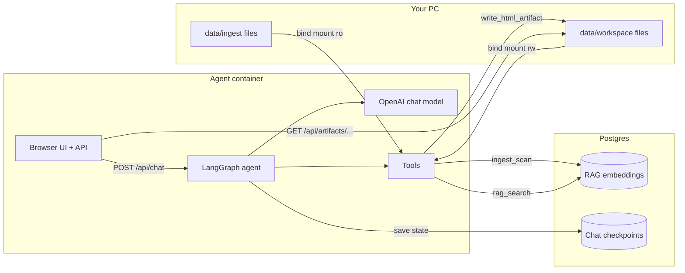

# Project structure guide (for new developers)

This document explains **what lives where**, **how data moves through the system**, and **which file to open first** when you want to change something. You do not need to read every file on day one—use the [reading order](#suggested-reading-order) at the end.

---

## What this project does (one sentence)

A **LAN web chatbot** reads documents from a shared folder, stores searchable embeddings in **Postgres**, remembers conversations in the same database, and can show **HTML dashboards** in a side panel—powered by **OpenAI**, **LangGraph**, and **Docker**.

---

## Big picture: two containers

When you run `docker compose up` from the `compose/` folder, you get:

| Container | Role |
|-----------|------|
| **agent** | Python app: web UI, API, AI agent, tools, file access |
| **postgres** | Database: document embeddings (RAG) + chat history (checkpoints) |

On your PC (host), two folders are **mounted** into the agent container:

| Host path | Inside container | Access |
|-----------|------------------|--------|
| `data/ingest/` | `/ingest` | **Read-only** — users drop documents here |
| `data/workspace/` | `/workspace` | **Read-write** — HTML files, scripts, ingest manifest |

Secrets and settings live in `compose/.env` (never commit this file).

---

## Data flow (how information moves)



### Step-by-step: user sends a chat message

1. **Browser** (`agent/app/static/app.js`) sends `POST /api/chat` with the message and a `thread_id` (conversation id).
2. **FastAPI** (`agent/app/main.py`) passes the request to `invoke_chat` in `agent/app/chat.py`.
3. **LangGraph** (`agent/graph/react.py`) runs the agent: the model may call **tools** (search documents, read files, write HTML, etc.).
4. **Tools** (`agent/tools/registry.py` and friends) read/write files under `/ingest` or `/workspace`, or query Postgres for RAG.
5. **Checkpoints**: after each step, conversation state is saved in Postgres via `PostgresSaver` (pool opened in `agent/app/checkpoints.py`).
6. **Response** goes back to the browser: text reply + optional `artifact_url` if an HTML file was registered.
7. **Artifact panel**: the iframe loads `/api/artifacts/{filename}.html` (served from `/workspace` on disk).

### Step-by-step: new documents appear in RAG

1. Someone copies files into `data/ingest/` on the host.
2. User (or the model) triggers **`ingest_scan`** tool.
3. `agent/rag/ingest.py` reads text files, splits them into chunks, embeds them with OpenAI, and stores vectors in Postgres (`agent/rag/store.py`).
4. A manifest file `data/workspace/.ingest_manifest.json` records file hashes so unchanged files are skipped next time.

**Important:** Chat messages are **not** embedded. Only files under ingest go into the RAG tables.

---

## Folder map (top level)

```
POCs/                          ← repo root
├── agent/                     ← all application Python code + web UI
├── sandbox/                   ← Docker image: Dockerfile + entrypoint
├── compose/                   ← docker-compose.yml + .env.example
├── examples/                  ← agent "profiles" (config per use case)
├── data/                      ← local data (git ignores contents except .gitkeep)
├── docs/                      ← human-written guides
├── postman/                   ← API tests for manual verification
├── pyproject.toml             ← Python package name, dependencies
├── README.md                  ← quick overview + links
└── PROJECT_STRUCTURE.md       ← this file
```

---

## Inside `agent/` (main codebase)

| Path | Responsibility |
|------|----------------|
| **`app/main.py`** | FastAPI app: routes (`/health`, `/api/chat`, `/api/artifacts`, static files) |
| **`app/chat.py`** | Turn user message into graph invoke; detect HTML artifact for UI; HITL resume |
| **`app/runtime.py`** | Startup: load profile, open DB pool, build compiled LangGraph |
| **`app/config.py`** | Read environment variables (`.env`) and load `examples/.../config.yaml` |
| **`app/checkpoints.py`** | Postgres connection pool for LangGraph checkpoints |
| **`app/static/`** | Chat web UI (`index.html`, `app.js`, `styles.css`) + **`vendor/`** (CSS/JS for generated HTML slides) |
| **`graph/react.py`** | System prompt + `create_react_agent` (model + tools + checkpointer) |
| **`tools/registry.py`** | Defines tools: ingest, RAG search, HTML artifacts, wires in fs/script tools |
| **`tools/fs_tools.py`** | `read_file`, `write_file`, `list_files` (path-safe) |
| **`tools/script_tools.py`** | `run_script` — run `.py` / `.sh` / `.js` under workspace |
| **`sandbox/paths.py`** | Security: relative paths only, no `..`, ingest vs workspace roots |
| **`sandbox/runner.py`** | Subprocess runner for workspace scripts (timeout, output limits) |
| **`rag/ingest.py`** | Scan ingest folder, chunk, embed, update manifest |
| **`rag/store.py`** | Create PGVector store connection to Postgres |

There is **no hand-written SQL schema** in this repo. Postgres tables are created automatically by **langchain-postgres** (RAG) and **langgraph-checkpoint-postgres** (chat state) on first use.

---

## Configuration: two layers

| Layer | File | What it controls |
|-------|------|------------------|
| **Runtime / secrets** | `compose/.env` | API keys, Postgres password, ports, host paths to `data/` |
| **Agent behavior** | `examples/<profile>/config.yaml` | Which tools are enabled, RAG chunk size, HITL on/off, artifact defaults |

The active profile name comes from `AGENT_PROFILE` in `.env` (default: `document-chatbot` → `examples/document-chatbot/config.yaml`).

To add a new product variant, copy an example folder, edit `config.yaml`, and set `AGENT_PROFILE` in `.env`. See [docs/REUSE_TEMPLATE.md](docs/REUSE_TEMPLATE.md).

---

## Tools the model can call (default profile)

| Tool | What it does |
|------|----------------|
| `ingest_scan` | Embed new/changed files from `/ingest` into Postgres |
| `rag_search` | Semantic search over embedded chunks |
| `extract_structured` | Read a specific ingest file (excerpt) |
| `list_files` / `read_file` / `write_file` | List or read/write under ingest or workspace (rules apply) |
| `run_script` | Run a script under `workspace/scripts/` |
| `write_html_artifact` | Write HTML to workspace; may **pause for human approval** (HITL) |
| `register_artifact` | Tell the UI to show an existing `.html` file in workspace |

Tool results that contain `ARTIFACT:filename.html` (or a mention of an existing HTML file in the current turn) cause the API to set `artifact_url` for the iframe.

---

## Web API (quick reference)

| Method | Path | Purpose |
|--------|------|---------|
| GET | `/` | Chat UI page |
| GET | `/health` | Liveness; includes whether the agent runtime started |
| POST | `/api/chat` | Send a message (`thread_id` optional) |
| POST | `/api/chat/resume` | Approve/reject HTML artifact after interrupt |
| POST | `/api/ingest` | Trigger ingest from API (no chat) |
| GET | `/api/artifacts` | List HTML files in workspace |
| GET | `/api/artifacts/{name}` | Serve one HTML file for the iframe |
| GET | `/static/...` | UI assets + `vendor/` for artifact styling |

---

## Where data is stored

| Data | Location | Notes |
|------|----------|--------|
| Raw uploads | `data/ingest/` | Not in Postgres until `ingest_scan` |
| Generated HTML, scripts | `data/workspace/` | Served as artifacts; manifest also here |
| Embeddings | Postgres tables `langchain_pg_*` | Created by PGVector library |
| Chat threads | Postgres tables `checkpoint_*` | Binary/msgpack blobs—not plain text in pgAdmin |
| Docker DB files | Docker volume `compose_postgres_data` | Survives container restart |

---

## Docker build path (why paths look confusing)

- **Build context** is the **repo root** (`compose/docker-compose.yml` sets `context: ..`).
- **Dockerfile** is `sandbox/Dockerfile`: copies `pyproject.toml`, `agent/`, `examples/`, runs `pip install .`, starts `lan-agent`.
- Code changes inside `agent/` require **`docker compose up --build`** from `compose/` (agent code is baked into the image, not bind-mounted).

---

## Human-in-the-loop (HITL) for HTML

In `examples/document-chatbot/config.yaml`, `hitl.enabled: true`. When the model calls `write_html_artifact`, LangGraph **interrupts** before saving. The UI shows Approve/Reject; `app.js` calls `/api/chat/resume`. If approved, the file is written and the artifact can appear in the iframe.

---

## “I want to change X — open this file”

| Goal | Start here |
|------|------------|
| Change agent personality / HTML rules | `agent/graph/react.py` (`SYSTEM_PROMPT`) |
| Enable/disable tools | `examples/document-chatbot/config.yaml` → `tools:` list |
| Add a new tool | Implement in `agent/tools/`, register in `registry.py`, add name to profile YAML |
| Change API routes or artifact serving | `agent/app/main.py` |
| Change chat response / artifact detection | `agent/app/chat.py` |
| Change UI layout or chat behavior | `agent/app/static/index.html`, `app.js`, `styles.css` |
| Change look of **generated** HTML slides | `agent/app/static/vendor/artifact.css` + prompt in `react.py` |
| Ingest file types or chunking | `agent/rag/ingest.py` + RAG section in profile YAML |
| Path security rules | `agent/sandbox/paths.py` |
| Postgres / env defaults | `compose/.env.example`, `agent/app/config.py` |
| LAN ingest share path | `compose/.env` (`INGEST_HOST_PATH`) or `docker-compose.lan.example.yml` |

---

## Suggested reading order

Read in this order the first time you explore the repo:

1. [README.md](README.md) and [docs/QUICKSTART.md](docs/QUICKSTART.md) — run the stack once.
2. [docs/SANDBOX.md](docs/SANDBOX.md) — ingest vs workspace mounts.
3. `compose/docker-compose.yml` — what gets mounted and which ports open.
4. `agent/app/main.py` — all HTTP entry points.
5. `agent/app/chat.py` — how a message becomes a graph run and an artifact URL.
6. `agent/graph/react.py` — how the agent is built.
7. `agent/tools/registry.py` — what the model is allowed to do.
8. `examples/document-chatbot/config.yaml` — profile-specific switches.
9. [docs/SECURITY.md](docs/SECURITY.md) — before exposing on a real LAN.

For deeper architecture history and decisions, see [docs/CODING_AGENT_TEMPLATE_PLAN.md](docs/CODING_AGENT_TEMPLATE_PLAN.md).

---

## Related docs (not duplicated here)

- [docs/MANUAL_VERIFICATION.md](docs/MANUAL_VERIFICATION.md) — smoke tests
- [postman/README.md](postman/README.md) — Postman collection
- [docs/REUSE_TEMPLATE.md](docs/REUSE_TEMPLATE.md) — fork for a new agent variant
